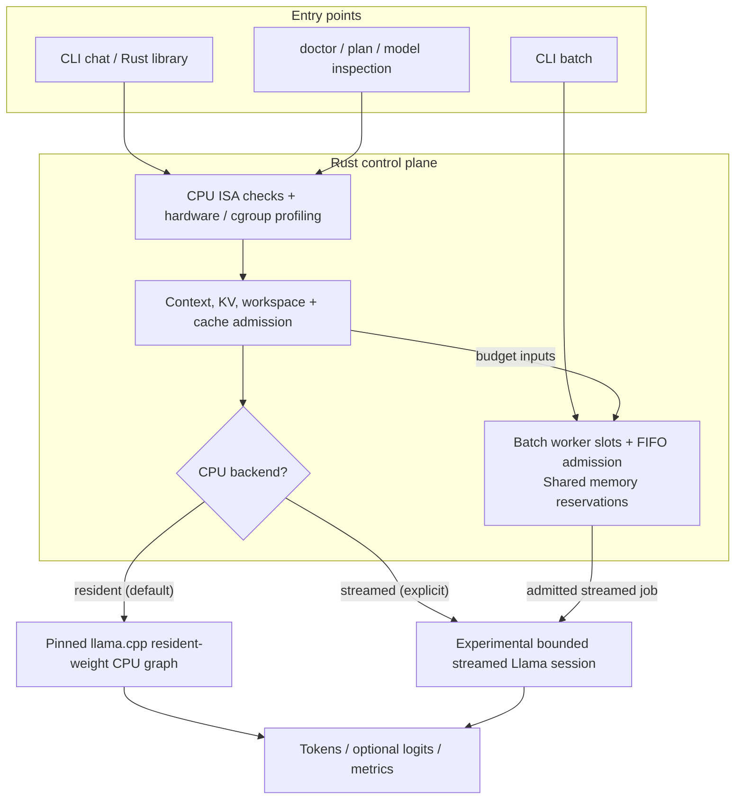
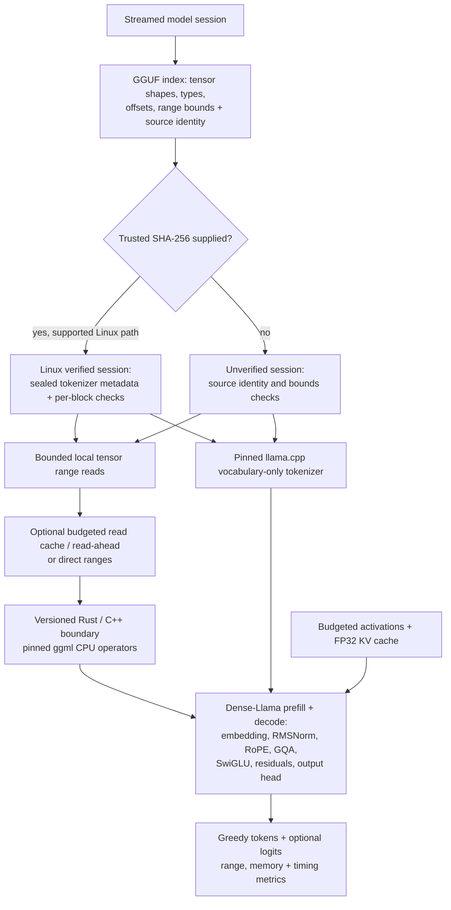

# LLM Bridge

**A standalone, vendor-agnostic Rust/C++ inference runtime exploring memory-aware execution of local large language models.**

LLM Bridge is an open engineering effort to make **local AI inference more accessible on machines with constrained RAM, CPU capacity, and optional or no GPU**. It is not tied to OpenMindAI, a cloud service, a specific GPU vendor, or a particular model provider.

> **Current reality:** Real CPU/GGUF generation and an **experimental complete streamed dense-Llama decoder** are implemented. The pinned 15M Q8 checkpoint completed reference-matched generation under a Linux 24 MiB address-space cap smaller than its model file. This is a tiny-model result; larger models, real 2 GB hardware, portable per-request limits, remote storage, API and desktop remain incomplete. See [streamed decoder validation](docs/STREAMED_DECODER.md).

## The problem we are solving

Running a large model locally is often limited by **model-weight storage, RAM residency, intermediate activations, KV cache, memory bandwidth, compute throughput, and operating-system pressure**. Downloading a model onto disk does not mean its inference workload fits in RAM. Likewise, memory mapping a model does not guarantee a bounded working set, acceptable latency, or survival under a tight memory limit.

Our research and engineering question is:

**Can an inference engine plan and execute model operations using explicitly budgeted tensor reads, reusable workspaces, adaptive scheduling, and measured memory admission, while preserving correct model outputs?**

The intended benefit is wider hardware access, including CPU-only systems. The goal is **not** to claim that arbitrary model sizes can run at useful speeds on arbitrary machines: disk I/O, bandwidth, computation, KV cache, and numerical correctness still impose real limits.

## What we want to build

1. **Portable runtime:** Rust control plane with a carefully versioned C ABI to native C++ kernels; CPU-first, with vendor-neutral acceleration considered only after measured CPU correctness.
2. **Model understanding:** Parse and validate model metadata, tensor types, shapes, quantization, offsets, alignment, file identity, and integrity before execution.
3. **Bounded tensor access:** Load only required file ranges into reusable, explicitly budgeted buffers; authenticate data when trusted hashes are supplied; reject corrupt or changing sources.
4. **Graph execution:** Connect streamed tensors to *real model graph operations*, including attention, feed-forward layers, and eventually complete prefill/decode, without silently reverting to unrestricted full-weight residency.
5. **Adaptive planning:** Admit or reject workloads based on available memory, CPU characteristics, context/KV-cache requirements, and measurable overhead; choose safe chunking and scheduling.
6. **Safe lifecycle:** Cancellation, transactional output behavior, cache isolation and eviction, failure containment across FFI, and deterministic resource cleanup.
7. **Reproducible proof:** Compare logits/tokens with trusted reference implementations; measure RSS/PSS, cgroup limits, latency, throughput, I/O, and behavior under constrained hardware.

These are **engineering targets**, not a list of completed features. See [AGENTS.md](AGENTS.md) for contribution rules.

## Architecture: current components and intended connection

The diagrams separate **what runs today** from the larger roadmap. Solid arrows show implemented request/data flow. The resident backend and the experimental streamed backend are different execution paths; the streamed backend does **not** silently fall back to the resident weight loader.

### 1. Requests, planning and backend selection



**What this means:** `chat` defaults to the pinned llama.cpp resident model-loading path. `chat --backend streamed` selects the separately implemented dense-Llama decoder. The `batch` CLI uses an admitted streamed-worker path with cooperative FIFO reservations; those reservations budget configured resources, **not whole-process RSS**. `doctor` and `plan` inspect capabilities and admission constraints without generating tokens.

### 2. Inside the streamed inference path



**Bounds and security:** Tensor weights reach native streamed operators through bounded Rust range reads; native upstream loading is vocabulary-only. Session-local caching is optional and disabled by default. Authenticated reads follow the verified-session policy (including per-range revalidation and cache bypass where required); the cache box is **not** an unconditional authenticated-cache hit. Cancellation and cooperative deadlines are checked at supported read, native polling and callback boundaries; a blocking native operation is not preempted.

**Measured scope:** The pinned tiny 15M Q8 GGUF has independent output/logit parity evidence under a Linux **24 MiB virtual-address-space limit (`RLIMIT_AS`)**. This is **not** proof of a hard portable RSS cap, physical 2 GB hardware support, arbitrary GGUF compatibility or large-model inference. See [streamed decoder evidence](docs/STREAMED_DECODER.md) and [verified sessions](docs/VERIFIED_MODEL_SESSIONS.md).

### 3. Intended connections (not yet complete)

The integration roadmap is to extend the existing decoder with broader model/quantization support, benchmark-driven CPU and I/O scheduling, asynchronous prefetch where safe, stronger portable worker isolation and resource enforcement, and reproducible low-memory **physical hardware** evidence. Queue admission, worker planning and cache-pressure controls already have implemented pieces, but they are not a globally adaptive or OS-enforced scheduler. Remote providers, GPU, MoE, public API and desktop integration remain separate later milestones.

### Where to find the code

| Location | Responsibility |
| --- | --- |
| `crates/llmbridge-cli/` | CLI entry point and developer commands |
| `crates/llmbridge-core/src/inference.rs` | Resident/native inference and operator boundary |
| `crates/llmbridge-core/src/streamed.rs`, `native/src/streamed.cpp` | Experimental dense-Llama prefill/decode using bounded tensor ranges and native CPU kernels |
| `crates/llmbridge-core/src/gguf_index.rs` | GGUF metadata and tensor inventory |
| `crates/llmbridge-core/src/storage.rs` | Bounded local file reads and source identity |
| `crates/llmbridge-core/src/tensor_batch.rs` | Bounded indexed tensor-range operations |
| `crates/llmbridge-core/src/tensor_cache.rs` | Budgeted chunk cache and revision isolation |
| `crates/llmbridge-core/src/read_cache.rs` | Optional bounded per-session cache/read-ahead and related accounting |
| `crates/llmbridge-core/src/queued_streamed.rs`, `streamed_executor.rs` | Queued streamed sessions, reservations and worker admission |
| `crates/llmbridge-core/src/streamed_plan.rs`, `worker_plan.rs` | Native-derived context/KV and worker-capacity planning |
| `crates/llmbridge-cli/src/batch.rs` | Bounded batch CLI execution |
| `crates/llmbridge-core/src/f32_stream.rs` | Streamed F32 matrix-vector operations |
| `crates/llmbridge-core/src/f32_chain.rs` | Two-stage F32 composition with caller-owned buffers |
| `crates/llmbridge-core/src/f32_residual.rs` | Streamed F32 residual composition |
| `crates/llmbridge-core/src/q8_batch.rs` | Native Q8 tensor operator experiments |
| `crates/llmbridge-core/src/memory_plan.rs` | Early memory/admission planning |
| `crates/llmbridge-core/src/runtime_memory.rs` | Process-memory measurement helpers |
| `docs/`, `benchmarks/`, `scripts/` | Validation protocols, benchmarks and reproducible checks |

Some components are experimental and may change as graph integration progresses. Code on open draft PR branches is **not** necessarily part of `main`.

## What works today vs. what remains open

| Area | Current state | Remaining proof or implementation |
| --- | --- | --- |
| M0 foundation | Rust workspace, CLI, native build and basic inspection | Continue portability and safety checks |
| M1 CPU baseline | Real GGUF tokenizer and native CPU generation; one small Q8 checkpoint matched pinned upstream greedy output in CI | Broader model families, cancellation and numerical validation |
| GGUF inventory | Indexed tensor shapes/types/offsets and checked ranges; independent 57-tensor comparison recorded | More malformed-format and compatibility coverage |
| Bounded storage | Range reader, source identity, optional integrity checks and streamed-decoder tensor reads | Broader models, authenticated-session portability and stronger full-process limits |
| Streamed decoder | Complete F32/Q8_0 dense-Llama path; pinned 15M output/logit and Linux address-space validation | Broader models, contexts, cache/prefetch and robustness |
| Memory accounting | Linux RSS/PSS and cgroup-related instrumentation | **Enforced** process memory bounds under real model loads |
| Adaptive planner | Native-derived context/KV/workspace estimates; worker queue, admission and optional cache-pressure controls | Full adaptive CPU/I/O scheduling and portable enforced worker limits |
| Large-model low-RAM inference | **Not verified** | Correctness, OS survival, I/O and latency evidence on actual constrained hardware |
| GPU and other formats | **Not advertised as supported** | Separate implementation and reproducible validation |

**Evidence:** [M1 test protocol](docs/M1_TEST_PROTOCOL.md), [compatibility matrix](docs/MODEL_COMPATIBILITY.md), and [implementation status](IMPLEMENTATION_STATUS.md). An M1 CI parity result is **not** proof of M2 streaming or strict-RSS behavior.

## Build and run

**Prerequisites:** Pinned Rust 1.85.1 (declared library minimum 1.82), CMake 3.22+, a C++20 compiler, Git, and network access on the initial build (CMake FetchContent retrieves pinned llama.cpp v0.9.0).

```sh
cargo build --release -p llmbridge
cargo run --release -p llmbridge -- doctor
cargo run --release -p llmbridge -- hardware --json
cargo run --release -p llmbridge -- models inspect /models/model.gguf
cargo run --release -p llmbridge -- chat /models/model.gguf --prompt "The sky is" --max-tokens 16 --ctx 128 --threads 2 --stream
```

The current `chat` command performs **raw prompt continuation**, not chat-template-validated conversational inference. It uses native tokenization, attention, CPU kernels, and greedy sampling; it does not send prompts to a remote service. Terminal Ctrl+C requests cooperative cancellation through native polling. A single blocking native operation remains non-preemptible.

No model weights are bundled. For a known small GGUF model, its pinned hash, source, and reproducible test procedure, consult [M1 test protocol](docs/M1_TEST_PROTOCOL.md). Respect each model's license.

### Inspect a streamed memory plan

```sh
cargo run --release -p llmbridge -- plan /models/model.gguf --ctx 128 --max-ram-mb 64 --json
```

This budget is an incremental admission estimate, not a process-RSS cap. Context reduction requires `--auto-context`; generation prints its chosen plan. [Planning protocol and limits](docs/STREAMED_MEMORY_PLANNING.md).

### Experimental streamed generation

```sh
cargo run --release -p llmbridge -- chat /models/model.gguf --prompt "The sky is" \
  --backend streamed --ctx 128 --max-tokens 8 --workspace-mb 8 --metrics
```

On Linux, `--sha256 <trusted-digest>` binds streamed generation to authenticated blocks and sealed tokenizer metadata. `--verification-mb` bounds verification overhead. [Verified session protocol](docs/VERIFIED_MODEL_SESSIONS.md).

Optional `--cache-mb 1` enables bounded session-local block caching/read-ahead, with source identity and cancellation checks on hits. Default caching is disabled. [Measured cache behavior](docs/STREAMED_CACHE.md).

For Linux standalone CLI use, `--address-space-mb 24` enforces `RLIMIT_AS`. This is a virtual-address limit, distinct from an explicit workspace budget, cgroup memory or physical machine RAM. Only the pinned tiny checkpoint has been verified end to end. [Protocol, evidence and limits](docs/STREAMED_DECODER.md).

### Run checks before proposing changes

```sh
cargo fmt --all -- --check
cargo test --workspace
cargo clippy --workspace --all-targets -- -D warnings
```

Native dependencies and test coverage may vary by platform; consult CI workflows for the exact environment and required model-parity jobs. Do not treat a successful unit test as a full model-parity or low-memory proof.

## Roadmap and acceptance criteria

**M2 — current priority:** Build on the experimental full-decoder checkpoint: extend verified sessions and bounded caches, prefetch, scheduling, portable worker limits, broader correctness and memory validation. The current Linux/tiny-model proof does **not** complete every M2 or product requirement.

**M3 — adaptive hardware/memory planning:** Calculate feasible context, KV-cache, activation and staging budgets; choose execution strategies based on measured hardware; fail safely when a workload cannot be admitted.

**Later milestones:** Expand execution coverage, supported model families and quantization, optional acceleration, integration interfaces, and production hardening. Their detailed requirements come from the project master specification and must be validated individually; this README does not claim they are complete.

### What would count as convincing evidence?

- **Correctness:** Same model checksum, tokenizer, prompt, sampling settings and reference version; report logits/tokens, tolerance where applicable, and mismatches.
- **Memory:** Record current and peak RSS/PSS, cgroup constraints, allocator/staging budgets, KV cache, OS and available RAM; demonstrate behavior under an enforced limit, not only an estimate.
- **Performance:** Record hardware, model size/quantization, context, cold/warm cache, first-token latency, tokens/sec, disk reads, and repeated trials.
- **Robustness:** Exercise cancellation during actual reads/compute, corrupt or replaced files, short reads, cache invalidation, malformed metadata, and FFI failures.
- **Reproducibility:** Pin source revisions and model hashes, publish commands and raw results, and clearly separate verified observations from hypotheses.

## Contributing

Contributions should advance **working, testable runtime functionality**, not only scaffolding or claims.

1. Read [AGENTS.md](AGENTS.md), [IMPLEMENTATION_STATUS.md](IMPLEMENTATION_STATUS.md), and the relevant module/tests.
2. Check existing issues and open PRs to avoid duplicate work; branch from current `main`.
3. Implement a small reviewable slice with regression tests and, where possible, a reference comparison.
4. Run relevant checks and include **actual commands and results** in the PR. If tests were not run, say so.
5. Open a **draft PR** while validation is incomplete. Do not merge untested work or publish unsupported performance/model-support claims.

For architecture questions, prefer concrete proposals specifying tensor flow, buffer ownership, cancellation boundaries, resource limits, and independent validation.

## Project boundaries

- **Independent project:** Not an OpenMindAI-only feature or cloud-backed inference service.
- **CPU-first:** No assumption of NVIDIA, CUDA, GPU availability, or a particular model vendor.
- **Security:** Untrusted model files require strict parsing, bounds checks, identity/integrity validation and safe native boundaries.
- **Honest claims:** `mmap` is not out-of-core proof; a small-model CI parity result is not large-model parity; a logical chunk-cache cap is not a process RSS cap.
- **Upstream:** The baseline C++ backend is pinned to [llama.cpp v0.9.0](https://github.com/ggml-org/llama.cpp/releases/tag/v0.9.0), commit `cd959bae99ff4bed22bef2604f45241c09bbb8c8`, behind a versioned Rust/C ABI.

**Status of this README:** Describes the repository's direction and confirmed checkpoints, not a claim that all roadmap capabilities are available on `main`.

### Streamed session timing

`chat --backend streamed --metrics` reports first-logits/piece readiness, actual sampling/decode intervals and range/consumer callback wall time. Collection is opt-in in the library and uses constant space. Run `python3 scripts/benchmark_streamed.py --binary target/release/llmbridge --model model.gguf --output /tmp/session-performance.json` for repeated real sessions, byte-complete output comparison against uninstrumented execution and optional measured-workload targets. These are page-cache-affected observations, with no physical-storage or larger-model claim. See [measurement semantics](docs/STREAMED_PERFORMANCE.md).

`--auto-cache` optionally selects a cache that fits after context and required reserves. Its default ceiling is 1 MiB; `--cache-mb N` changes the ceiling. It can select zero without reducing context. Plans report the exact selected byte budget used by execution. See [adaptive cache admission](docs/STREAMED_MEMORY_PLANNING.md#adaptive-cache-admission).

### CPU compatibility

Run `llmbridge doctor --json` before using this build on another PC. The default x86 native profile requires SSE4.2/AVX/AVX2/FMA/F16C/BMI2 and OS AVX state support. Rust native entry paths reject incompatible CPUs before FFI instead of selecting an unvalidated scalar fallback. CPU capability is separate from core count and RAM. [Admission and emulated-host validation](docs/NATIVE_CPU_COMPATIBILITY.md).

### Experimental Q4_0 streamed execution

The dense Llama streamed path also accepts Q4_0 tensors through bounded row reads and pinned ggml CPU primitives. A reproducible Q8-to-Q4 fixture and explicit reference numerical profile test execution agreement; this does not measure model quality or prove larger-model/2GB feasibility. [Derivation, configuration and validation](docs/STREAMED_Q4_VALIDATION.md).

### Explicit pre-AVX2 CPU build

`LLMBRIDGE_CPU_PROFILE=baseline cargo build --release --locked --target-dir target/baseline` produces a separate x86-64/SSE2 artifact. The default AVX2 binary keeps its guard and does not silently fall back. Pinned tiny Q8/Q4 execution is compared with an independent matching reference on the host and under Core 2 Duo CPU emulation. This is not a physical 2GB-machine or speed claim. [Build and validation details](docs/BASELINE_CPU_BUILD.md).

### Optional cache pressure handling

`chat --backend streamed --cache-mb 1 --cache-pressure-mb 512 --metrics` can release optional cache allocations when effective available RAM drops below the floor. KV/context and authentication remain intact. The library also exposes a cooperative per-session release signal; no cache regrowth or RSS guarantee is implied. [Semantics and forced-signal validation](docs/RUNTIME_CACHE_PRESSURE.md).

Linux memory admission includes headroom from every visible cgroup-v2 ancestor, including sibling usage. [Discovery, regression coverage and namespace limits](docs/CGROUP_MEMORY_ADMISSION.md).

### Streamed batch jobs

Run newline-delimited UTF-8 prompts with `llmbridge batch model.gguf --input prompts.txt --output-dir new-results --workers 2 --sha256 TRUSTED_SHA256`. A shared planned executor processes bounded input per worker and streams each response to its own file. Existing outputs are protected; admission timeout and optional pressure hysteresis are available. See [batch CLI](docs/BATCH_CLI.md) for defaults, cancellation and accounting limits.
